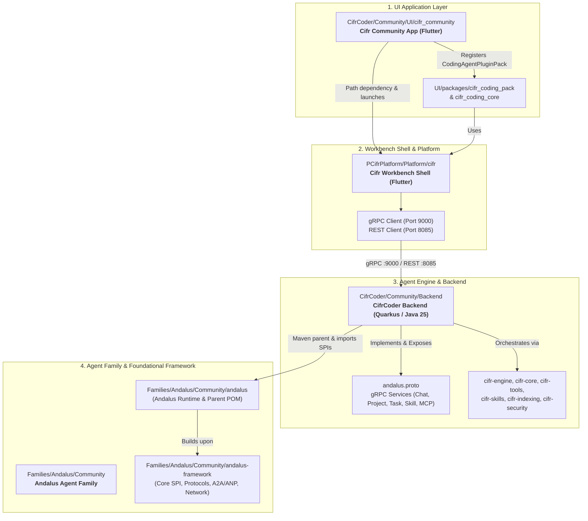

# Cifr Coder Community 
---

### 🏛️ High-Level Architecture & Relationship Diagram

---

### 1. UI Entry Point: `cifr_community`
* **Path:** [`CifrCoder/Community/UI/cifr_community`](CifrCoder/Community/UI/cifr_community)
* **Role:** The standalone Flutter desktop/mobile application runner for the Community Edition of CifrCoder.
* **Key Configuration & Code:**
  * [`pubspec.yaml`](CifrCoder/Community/UI/cifr_community/pubspec.yaml): Resolves path dependencies to `cifr` (workbench shell), `cifr_plugin_api`, `cifr_coding_pack`, and `cifr_coding_core`.
  * [`lib/main.dart`](CifrCoder/Community/UI/cifr_community/lib/main.dart): Boots the application by invoking `platform.runCifrApp(edition: CifrEdition.community, additionalPlugins: [CodingAgentPluginPack()])`.
  * Delegates all UI frame lifecycle, window setup, and base services to `CifrPlatform`.

---

### 2. Workbench Platform: `cifr`
* **Path:** [`PCifrPlatform/Platform/cifr`](CifrPlatform/Platform/cifr)
* **Role:** The core workbench platform (shell, docking, navigation, plugin system, settings, sessions, chat history).
* **Communication with Backend:**
  * [`lib/data/grpc_backend_service.dart`](CifrPlatform/Platform/cifr/lib/data/grpc_backend_service.dart): Implements `BackendService` by consuming gRPC stubs generated from `andalus.proto`.
  * [`lib/data/grpc_client.dart`](CifrPlatform/Platform/cifr/lib/data/grpc_client.dart): Connects by default to `127.0.0.1:9000` with the `x-tenant-id: default-tenant` header.
  * [`lib/data/backend_providers.dart`](CifrPlatform/Platform/cifr/lib/data/backend_providers.dart): Riverpod provider toggling between gRPC (port `9000`) and REST (port `8085`).

---

### 3. Coder Agent Backend: `CifrCoder/Community/Backend`
* **Path:** [`CifrCoder/Community/Backend`](CifrCoder/Community/Backend)
* **Role:** Java 25 & Quarkus (v3.32.2) reactive agent engine and server.
* **Module Breakdown:**
  * [`cifr-api`](CifrCoder/Community/Backend/cifr-api):
    * Exposes gRPC server on `0.0.0.0:9000` and HTTP/REST on `8085`.
    * Implements `andalus.proto`: `ProjectService`, `ChatService` (with `RunAgent` streaming events), `TaskService`, `SkillService`, `McpService`, `MemoryService`, and `SdkService`.
  * [`cifr-engine`](CifrCoder/Community/Backend/cifr-engine):
    * Autonomous coding loop (`AgentLoop`, `CodingLoop`, `DefaultClosedLoopCoder`).
    * AST parsing, repair planner, debug engine (`HypothesisScorer`, `RepairPlan`), test intelligence, and prompt compiler.
  * [`cifr-core`](CifrCoder/Community/Backend/cifr-core), [`cifr-tools`](CifrCoder/Community/Backend/cifr-tools), [`cifr-skills`](CifrCoder/Community/Backend/cifr-skills), [`cifr-indexing`](CifrCoder/Community/Backend/cifr-indexing), [`cifr-security`](CifrCoder/Community/Backend/cifr-security):
    * Workspace AST indexer, sandboxed mutation/patch gate, capability resolver, and security policies.

---

### 4. Agent Family: `Families/Andalus/Community`
* **Path:** [`Families/Andalus/Community`](Andalus/Community)
* **Role:** The foundational framework and runtime on which the Andalus agent family is built. Contains two repositories:
  1. [`andalus`](Andalus/Community/andalus):
     * The **Andalus Runtime** (`tech.kayys.andalus:andalus-parent:0.0.1`).
     * Acts as the parent Maven POM for `CifrCoder/Community/Backend`.
     * Provides runtime execution pipelines, RAG runtime, HITL (human-in-the-loop), graph execution, agent sandbox, and CLI/TUI interfaces.
  2. [`andalus-framework`](Andalus/Community/andalus-framework):
     * The **Andalus Framework** (`tech.kayys.andalus:andalus-framework-parent:0.0.1`).
     * Provides foundational SPIs: agent-to-agent communication (`andalus-a2a`), Agent Network Protocol (`andalus-agent-network-api` / `core`), context management, embedding SPI, and memory protocols.

---

### Summary of Inter-Connections

| Component | Depends On / Consumes | Protocol / Mechanism |
|---|---|---|
| **`cifr_community` (UI)** | `CifrPlatform/Platform/cifr` | Flutter path package dependency (`runCifrApp`) |
| **`cifr` (Platform)** | `CifrCoder Backend` | gRPC over port `9000` (and REST on `8085`) defined by `andalus.proto` |
| **`CifrCoder Backend`** | `Families/Andalus/Community/andalus` | Maven `<parent>` POM and `andalus-*-spi` dependencies |
| **`Families/Andalus/Community`** | `andalus-framework` | Fundamental contracts, protocols (A2A), and agent runtime abstractions |